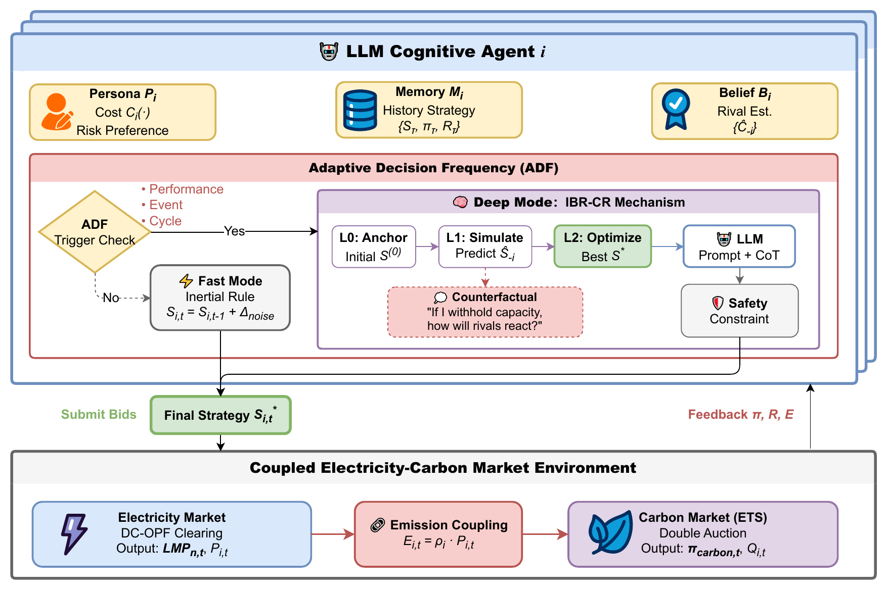
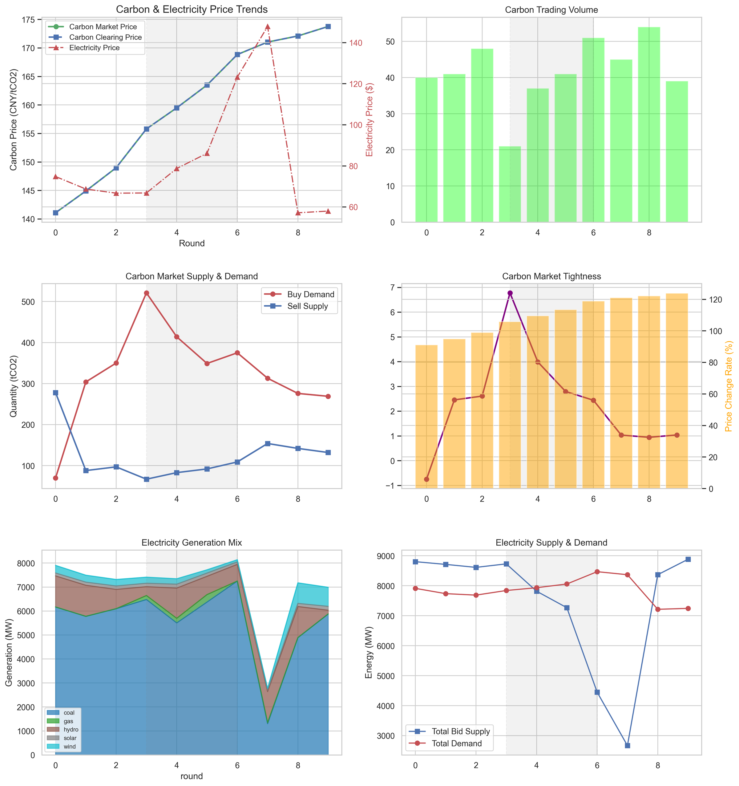

# LLM-CECM in five minutes

[Project home](../README.md) · [Reference results](../results/README.md) · [Reproducibility status](reproducibility.md)

**Source status:** the retained tables and images were published during AI-assisted repository preparation.
Only selected headline effects have been checked against the published abstract; the origin of each retained
artifact is still being established. See [the provenance note](provenance.md).
They have not been established as original-run records.

## The question

How do generators adjust their bids when a carbon-policy announcement changes the expected cost of producing
electricity? A bid changes dispatch, dispatch changes emissions, and emissions change the generator's carbon
position. A useful simulation needs both markets and the feedback between them.

LLM-CECM models 50 generation companies on the IEEE 118-bus system. Each agent combines its technology and
costs with market observations, beliefs about competitors and a memory of earlier decisions. It submits
structured electricity and carbon bids, then receives clearing results and profit feedback.



## A policy-shock scenario

The released experiment 1 announces a carbon-price shock at round index 1, to take effect at index 7.
It also announces a gas-price shock at index 3, to take effect at index 6. These are configured simulation
events, not a replay of an observed policy episode.

The sequence to inspect is:

1. An agent reads the announced event alongside its operating costs and recent market history.
2. In Deep Mode, it considers a candidate bid, simulates a rival's response and revises its decision.
3. The electricity and carbon markets clear, and the agent updates its profit, beliefs and memory.
4. Adaptive Decision Frequency (ADF) decides whether another full reasoning call is needed or a cheaper
   Fast-Mode adjustment is sufficient.

The existing repository image illustrates coupled-market behavior. Its original source remains unverified;
the underlying per-round run is not bundled for interactive replay.



## The cost–behavior tradeoff

The most direct engineering comparison in the retained summaries is Table IV:

| Quantity | Full-frequency IBR | IBR with ADF |
|---|---:|---:|
| LLM calls | 10,805 | 2,105 |
| Total runtime | 32.95 hours | 6.08 hours |
| Average simulated electricity price | 45.46 CNY/MWh | 45.63 CNY/MWh |
| Total simulated profit | 141,654 CNY | 137,709 CNY |

[Source CSV](../results/exp2_adf_efficiency/table4_adf_efficiency.csv).
The table reports about 80.5% fewer calls and 81.5% less runtime, with a small difference in its average price.
This describes one retained comparison, not a general guarantee across models or markets. The separate
Monte Carlo summary in Table V has different totals; it is not pooled into this comparison.

The counterfactual-reasoning summary reports price volatility of 5.49 versus 2.69 CNY/MWh and convergence at
round 31 over a 72-round horizon. The current released experiment 3 is 30 rounds and does not implement
that convergence statistic. Those values remain reference claims requiring additional original materials
for replication. Lower simulated volatility alone does not establish an equilibrium.

## Try the software

From the repository root, inspect a configuration with only Python installed:

```bash
python3 src/run_experiments.py --experiment exp3 --dry-run
python3 src/run_experiments.py --experiment all --quick-test --dry-run
```

The inspection reports effective horizons, scenario coverage, reference units and known replication gaps.
It does not construct agents, call an API or write simulation results.

For the offline software checks, install the dependencies and run:

```bash
make install
make test
```

The deterministic mock tests exercise market clearing, ADF switching, belief revision, memory and result
logging without paid model calls. They validate software behavior. To run a real LLM scenario, configure
the API key as described in the [project README](../README.md#build-and-run).

## What is established, and what remains open

- The repository provides a runnable simulation framework, configurable agent mechanisms and offline tests.
- Its six result CSVs and five result images preserve reference summaries, without the original run-level logs.
- The observed NSW1 reference is in AUD/MWh; simulated results are labelled CNY/MWh. No conversion is inferred,
  and mismatched-unit series are not overlaid on the same price axis.
- Complete replication of the reported experiment 3 requires its original operational scenario, subregion,
  convergence definition and per-round records. Publishing a 72-hour price series does not supply them.

## Publication and credit

Yuheng Cheng, Yike Chen, Xiyuan Zhou, Xuning Tan, Xuanang Gui, Huan Zhao, Wenxuan Liu and Junhua Zhao.
*LLM-CECM: A simulation framework for strategic generation behavior in coupled electricity-carbon markets.*
Renewable Energy 273 (2026), 126139. [DOI](https://doi.org/10.1016/j.renene.2026.126139).

The publisher's contributor statement credits Yike Chen with **Investigation** and **Data curation**.
This overview describes the team's framework; it does not assign sole authorship of the software or research
to an individual. See the [publisher record](https://www.sciencedirect.com/science/article/abs/pii/S0960148126009651).
